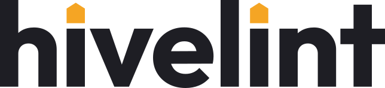

  <picture>
    <source media="(prefers-color-scheme: dark)" srcset="assets/hivelint-wordmark-reversed.svg">
    
  </picture>

<strong>Lint your launch with a hive.</strong>

Hivelint shows your tweet, ad or landing page to a crowd of synthetic people before the real crowd sees it — and tells you who loves it, who is annoyed and who doesn't get it.

We're building it in the open for the **Nebius × NVIDIA Global AI Hackathon**, on NVIDIA Nemotron models served by Nebius Token Factory.

- **Status:** in development · public release late October 2026
- **License:** MIT, once the code goes public

> Synthetic personas, not real people. A directional signal, not ground truth.
